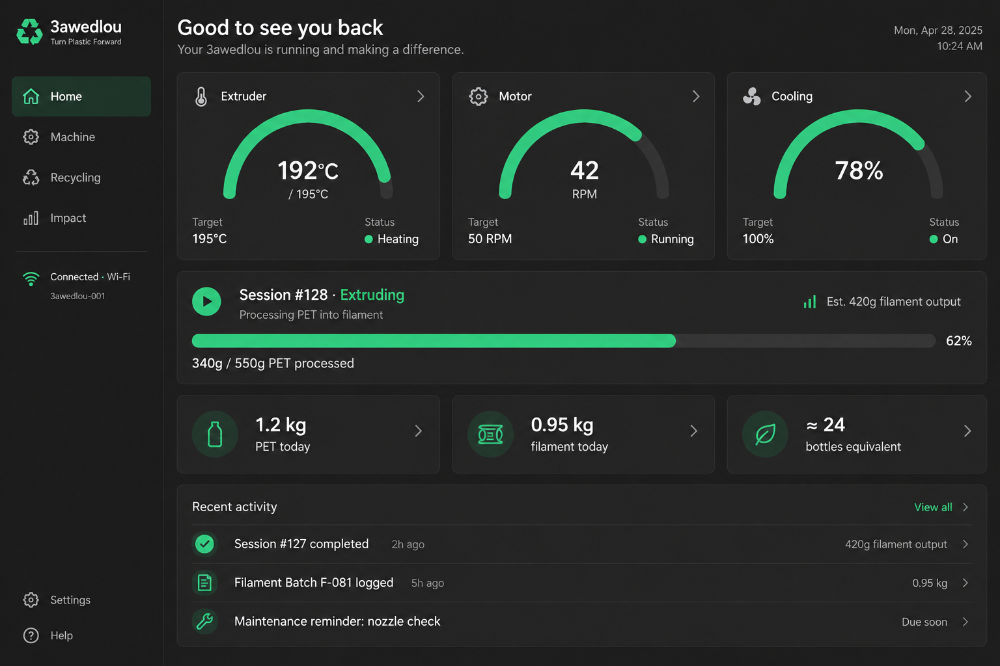
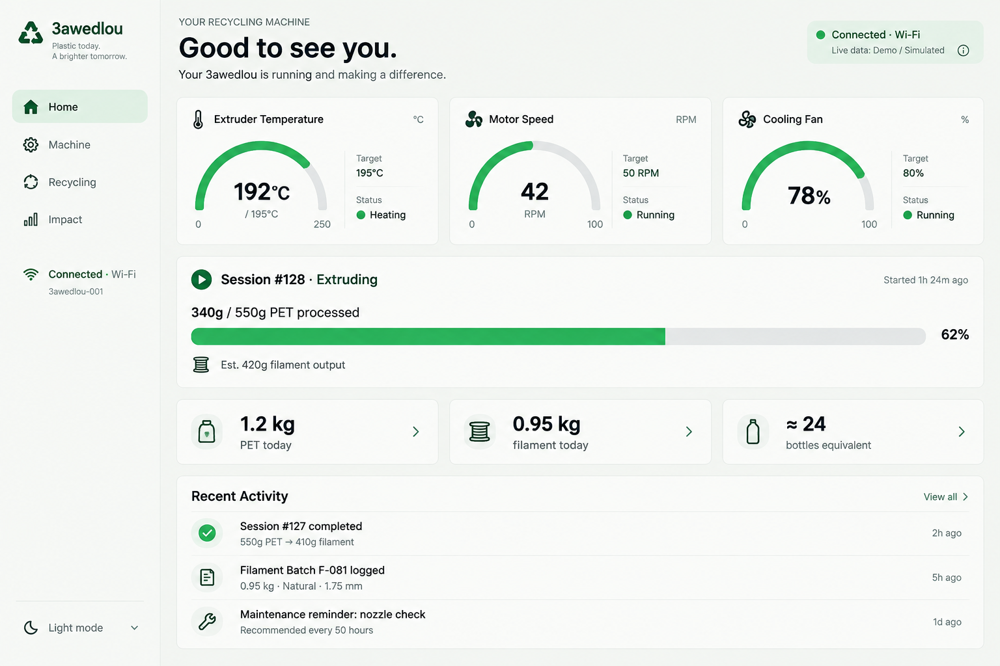
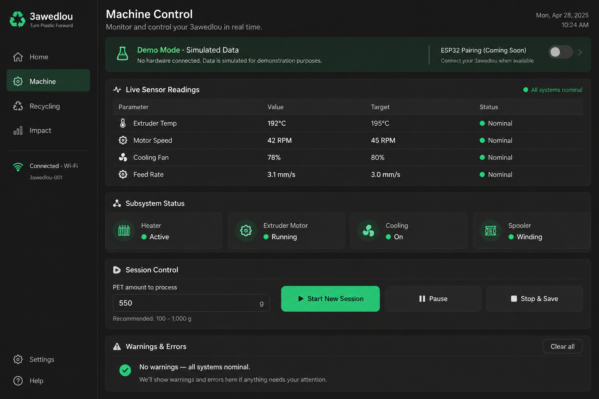
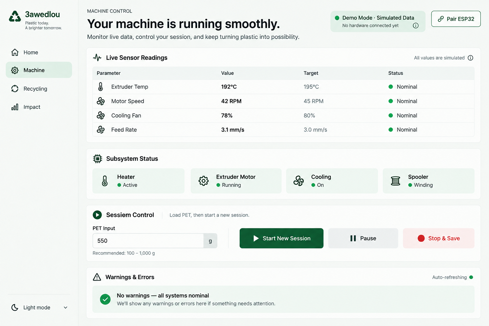
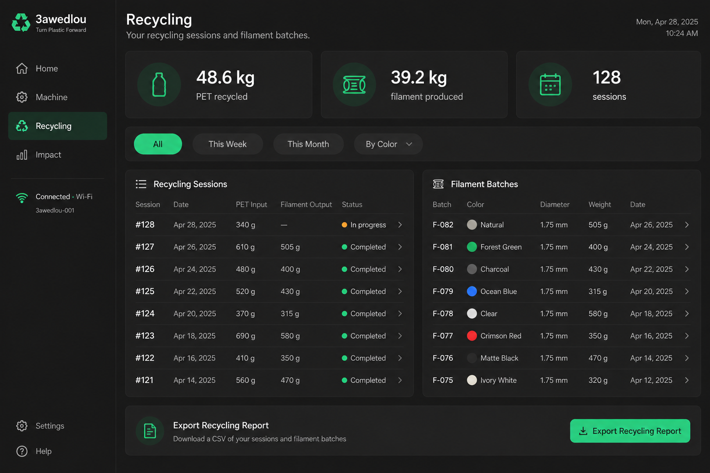
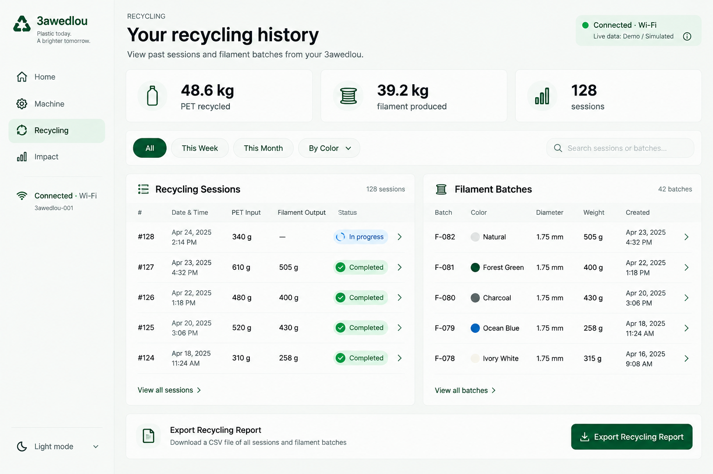
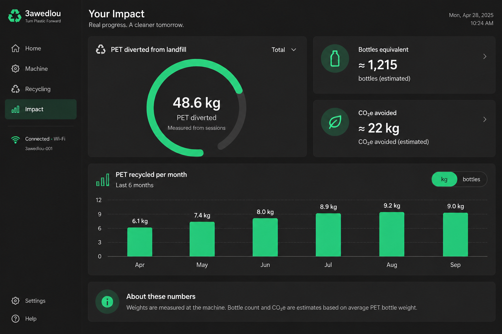
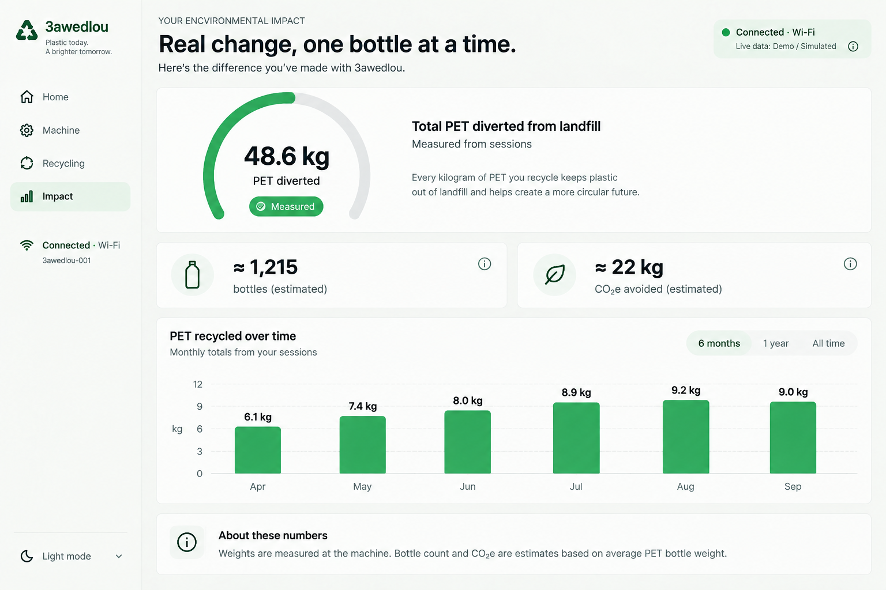

# 3awedlou · Web app

Dashboard for the 3awedlou smart PET recycling machine.

Built with **React 18 + Vite 5 + TypeScript** — no UI framework, custom design
system in `src/styles` (brand green identity). It talks to the same Symfony
backend as the mobile app: one API, one JWT scheme, one contract (the backend
README is the contract).

## Run it

1. Start the Symfony backend (`../PET-Recycling-Filament-System-Backend/README.md`)
   — by default on `http://127.0.0.1:8000`.
2. Create `.env` from `.env.example`:

   ```ini
   VITE_API_BASE_URL=http://127.0.0.1:8000/api
   VITE_REALTIME_URL=
   VITE_ENVIRONMENT=development
   ```

3. `npm install && npm run dev` → http://localhost:5173

Dev accounts come from backend fixtures (dev only): `anouer@3awedlou.app` /
`3awedlou-dev`.

| Command | What it does |
|---|---|
| `npm run dev` | Vite dev server on :5173 |
| `npm run build` | Production build into `dist/` |
| `npm run preview` | Preview the production build |
| `npm run typecheck` | `tsc --noEmit` |
| `npm test` | Vitest + React Testing Library (jsdom) |

## Screens and backend calls

| Screen | Route | Backend calls |
|---|---|---|
| Login / register | auth gate (no route) | `POST /auth/login`, `POST /auth/register`, `GET /me` on restore |
| Dashboard | `#/dashboard` | `GET /machines`, `GET /machines/{id}/dashboard`, `GET /machines/{id}/sessions` |
| Machine | `#/machine` | dashboard + `POST /machines/{id}/commands`; telemetry refresh via the realtime service |
| AI assistant | `#/agent` | `POST /agent/chat`, `DELETE /agent/conversations/{id}`, `DELETE /agent/conversations` |
| Recycling | `#/recycling` | `GET /machines/{id}/recycling` (totals), sessions + production lists |
| Filament | `#/filament` | `GET /machines/{id}/production` |
| Impact | `#/impact` | `GET /machines/{id}/recycling` (measured totals + estimates) |
| History | `#/history` | `GET /machines/{id}/sessions`, production, telemetry history |
| Settings | `#/settings` | `GET /me` (session restore) + dashboard telemetry from context |
| Notifications | shell panel | derived client-side from dashboard + recent sessions |

## Honesty rules in the UI

* **Unreported is not zero.** A telemetry channel stays `null` unless the sample
  is fresh; the UI shows “Not reported” (gauges, stat cards, tables) and never
  invents `0`/`off`. A stale sample is ignored rather than presented as current.
* **Units are not invented.** Motor speed has no confirmed firmware unit and is
  labelled “unit unverified”; other units come from the telemetry contract.
* **Totals are measured only.** PET/filament totals come from recycling records
  and production weights; a missing weight is excluded and labelled, not counted
  as zero. Bottle counts and CO₂e are explicitly estimates.
* **Broker acceptance ≠ execution.** Command responses show the backend's
  `delivery` state (published to broker / buffered, not sent) and
  `deviceAcknowledged: false`; the user is told to confirm from fresh telemetry.
  The stop dialog says it cannot confirm heater or spooler state.
* **Polling is labelled polling.** No WebSocket exists; the footer says “API
  refresh 10 s”, never “Live”.

## Architecture

```text
src/
├── api/
│   ├── client.ts            # fetch + Bearer token + envelope + 401 flow
│   ├── auth.ts              # login / register / me / logout
│   ├── machines.ts          # machines, telemetry, sessions, production, recycling, commands
│   └── agent.ts             # assistant chat + conversation deletes
├── realtime/realtimeService.ts  # 10 s polling + future socket interface
├── types/api.ts             # backend contract types (hand-maintained copy)
├── contexts/                # Auth, Machine, Theme, Toast providers
├── pages/                   # Dashboard, Machine, AgentChat, Recycling, Filament, Impact, History, Settings, Login
├── components/              # layout, ui kit, charts, icons, agent components
├── lib/                     # router, format, csv, freshness, delivery copy, chat hook, useAsync
├── data/types.ts            # UI-only types
└── styles/                  # tokens + component/page styles
```

Key rules:

* **One API contract** — `src/types/api.ts` mirrors the backend README; update
  both clients and the backend together when a field changes.
* **Auth is centralized** — components never read tokens; `api/client.ts`
  attaches the Bearer token, `AuthContext` owns the session, and 401 triggers a
  single logout path.
* **Machine actions are guarded commands** through
  `POST /machines/{id}/commands`; the backend validates state and ranges before
  anything reaches hardware.
* **Realtime is polling today** — `REFRESH_MS = 10_000` in
  `src/realtime/realtimeService.ts`. A configured `VITE_REALTIME_URL` is kept as
  a future socket target and never disables polling; `connect()` is a no-op.

## Data flow

```text
Machine → Arduino Mega → ESP32 → MQTT broker → Symfony consumer → PostgreSQL
PostgreSQL → Symfony API → this app (10 s polling)
Commands: browser → Symfony (guard → audit → MQTT) → ESP32 → Mega → machine
```

Web/Mobile never talk to MQTT, to the machine, or to each other; Symfony is the
single backbone. MQTT is prepared but has not been run against a live broker.

## Status

`Implemented` = code plus a passing test or verified local run.
`Prepared` = code exists but is exercised only by fakes/mocks.
`Future` = not implemented.

| Area | State |
|---|---|
| Auth screens + session restore | Implemented |
| Dashboard, machine, recycling, filament, impact, history, settings | Implemented |
| Null/stale telemetry handling and unit labelling | Implemented |
| Guarded command UI with delivery honesty | Implemented (backend guard verified; no physical device) |
| AI assistant screen (non-streaming, explicit retry) | Prepared — mocked API tests only; no live provider |
| Realtime transport | Future — 10 s polling is implemented and labelled |
| Browser visual/E2E pass | Future — no automated browser run is wired |
| Refresh-token storage/rotation/logout revocation | Future by design — the web keeps only the short-lived access token and logs out on 401; cookie-based refresh is not implemented |

## Prerequisites

| Tool | Version |
|---|---|
| Node.js | 20 (what CI uses; no `engines` field is declared) |
| npm | 11 (CI installs npm 11 because npm 10's Arborist crashes on current registry peers) |

## Configuration

| Variable | Required | Default | Meaning |
|---|---|---|---|
| `VITE_API_BASE_URL` | yes | `http://127.0.0.1:8000/api` | Symfony API base (same backend as mobile) |
| `VITE_REALTIME_URL` | no | empty | Future socket target only; polling continues regardless |
| `VITE_ENVIRONMENT` | no | `development` | Footer label and log verbosity |

`VITE_*` values are embedded in the bundle at build time: never put credentials
there. Local overrides go in `.env` (git-ignored); committed `.env.example` holds
placeholders.

## Testing and quality

```bash
npm run typecheck    # tsc --noEmit
npm test             # vitest run: 7 files / 92 tests
npm run build        # vite build (verifies bundling)
```

Latest results (2026-11-11): typecheck passes, **92 tests in 7 files pass**,
build succeeds. Tests stub `fetch` and never touch the network; there is no
lint step. CI (`.github/workflows/ci.yml`) runs Node 20 + npm 11, `npm ci`,
typecheck, tests and build.

Manual check of every relative README link/path:

```bash
node scripts/check-readme-links.mjs
```

## AI assistant (web)

The assistant is a read-only chat screen (`#/agent`). It uses the normal user
JWT; no provider key reaches the browser. It can read machines, telemetry,
events, fault codes and the activity log; there is no write tool and the screen
never imports the machine-command API.

Backend requirements:

1. `AGENT_ENABLED=true` in the backend `.env.local`.
2. Agent migrations applied.
3. `ANTHROPIC_API_KEY` in the backend `.env.local` for real answers (otherwise
   `503 AGENT_LLM_UNAVAILABLE`).

Behaviour: one in-flight turn, no automatic retry (retry is an explicit button),
typed notices for validation/rate limit/daily cap/provider/disabled, and 404
disables the surface only when the payload carries `AGENT_DISABLED`. Messages
are capped at 4000 characters; answers are not streamed. No live provider call
has ever been made from this project, so real answer quality is unverified.

## Project structure

```text
.
├── docs/screenshots/        # committed UI captures (README gallery)
├── scripts/                 # README link checker, PNG downscaler
├── src/                     # app source (see Architecture)
├── index.html
├── package.json
├── tsconfig.json
├── vite.config.ts
├── vitest.config.ts
└── README.md
```

## Screenshots

| Dark | Light |
|---|---|
|  |  |
|  |  |
|  |  |
|  |  |

The committed PNGs are the current captures; there is no automated screenshot
export command. `scripts/downscale-png.mjs` resizes a supplied image.

## Security notes

* The **access token is stored in `localStorage`**, so any XSS on the origin can
  read it. The backend returns a refresh token but this client deliberately does
  **not** store or use one: on 401 it ends the session (local token cleared),
  and logout clears only that access token. Cookie-based refresh with
  server-side revocation is **Future**, not a hidden behaviour.
* Auth surface is rate-limited by the backend (login 5/5 min, register 3/10 min,
  refresh 30/5 min per IP).
* `VITE_*` values are public by construction. Never put tokens, broker
  credentials or JWT keys in this repository.
* The backend dev broker is plaintext loopback only; never expose it.

## Troubleshooting

| Symptom | Likely cause | Fix |
|---|---|---|
| API unreachable | Backend not running / wrong base URL | Start the backend and check `VITE_API_BASE_URL` |
| CORS error on login | Backend origin regex too narrow | Match the Vite origin in backend `CORS_ALLOW_ORIGIN` |
| `npm install` Arborist crash | npm 10 peer resolution bug | Use npm 11 (`npm install -g npm@11`) |
| Login returns `429` | Rate limit | Wait `Retry-After`, or relax the limiter in local backend config |
| `EADDRINUSE` on 5173 | Port occupied | Stop the other process or run Vite on another port |
| Gauges show “Not reported” | No fresh telemetry | Expected; the device has not reported, or the sample is stale |
| `deviceAcknowledged` is always `false` | No firmware ack channel exists | Expected until firmware acknowledgements ship |

## Related repositories

* Backend (API/MQTT/agent contract): https://github.com/AnouerChouikhgithub/PET-Recycling-Filament-System-Backend/blob/main/README.md
* Mobile: https://github.com/AnouerChouikhgithub/PET-Recycling-Filament-System-Mobile/blob/main/README.md
* Hardware: https://github.com/AnouerChouikhgithub/pet-recycling-filament-system

## License

TODO(anouer): no LICENSE file exists in this repository — add one.
